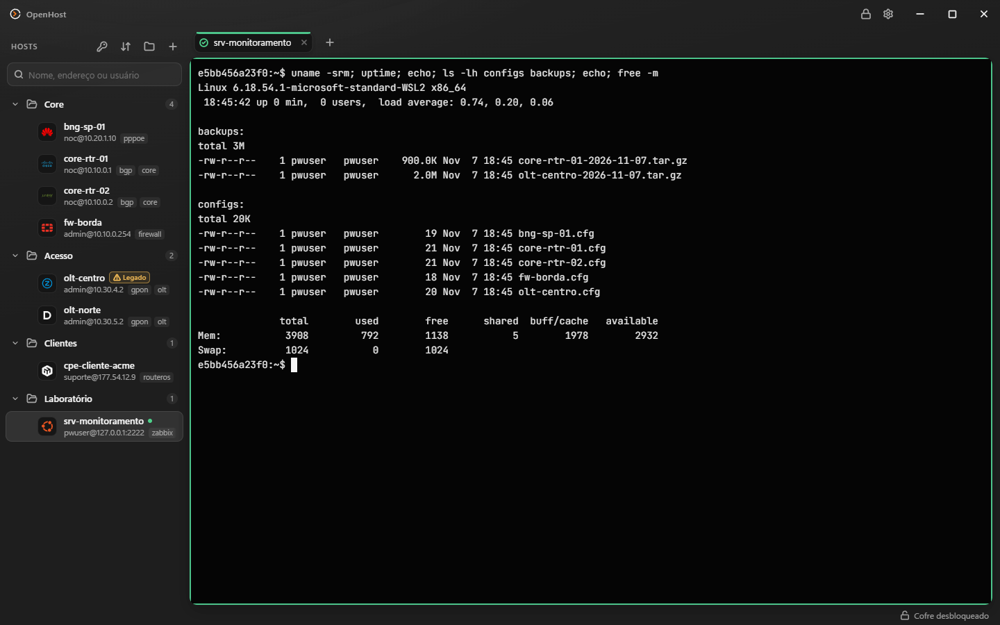
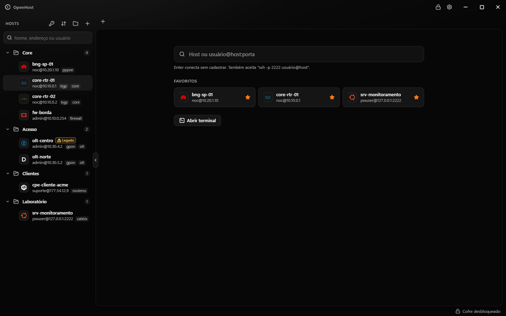
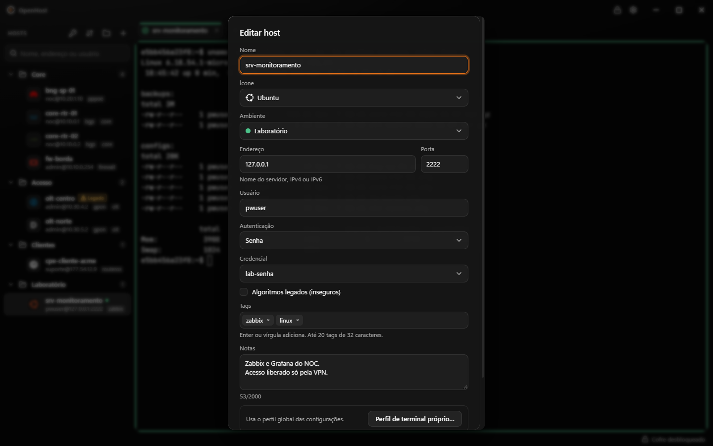
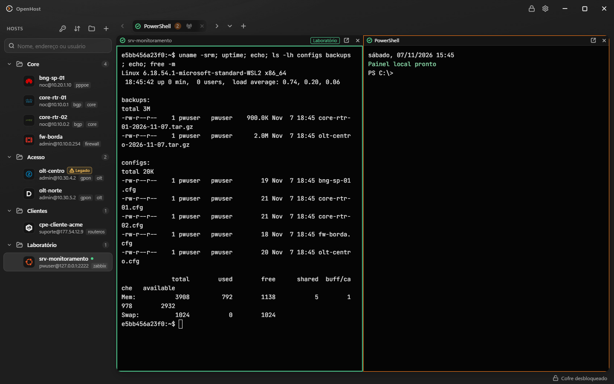
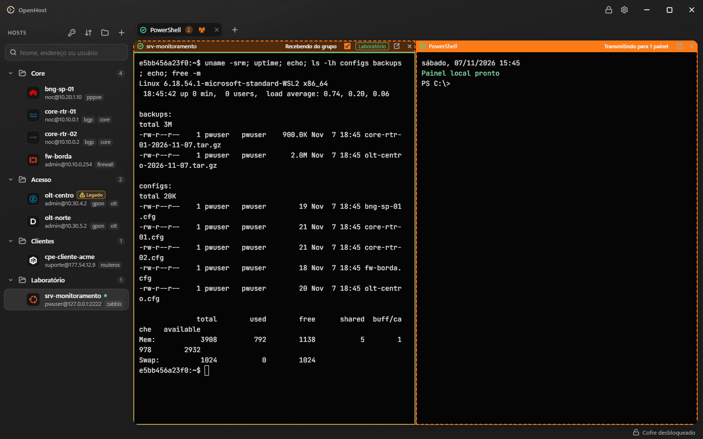
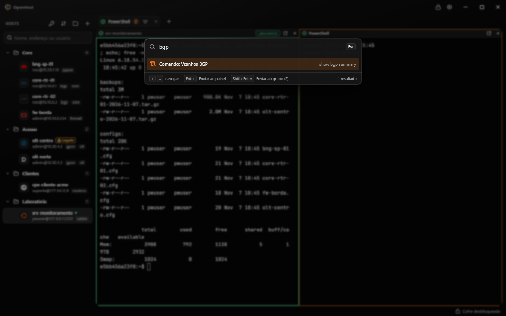
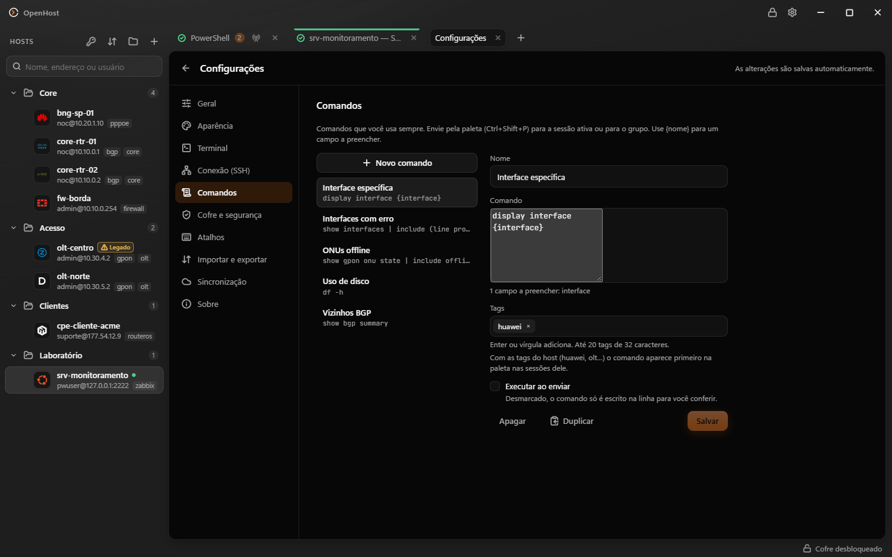
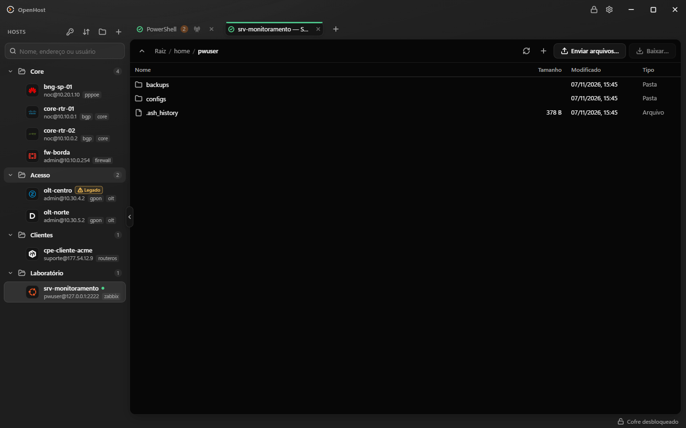
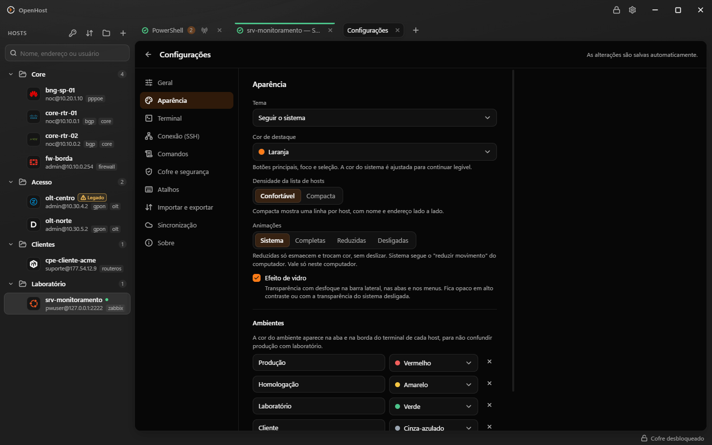

# OpenHost

Cliente SSH de desktop para quem passa o dia no terminal, feito para equipes de redes,
infraestrutura e NOC. Reúne terminal SSH e local em abas, cofre criptografado de senhas e chaves,
SFTP, encaminhamento de portas, comandos salvos e painéis lado a lado num app nativo para Windows,
Linux e macOS.

**[Baixar a versão mais recente](https://github.com/EmersonRicard0/Openhost/releases/latest)** ·
versão atual: 0.9.0



## O que ele faz

**Cofre local e seguro**
- Senhas, chaves privadas e passphrases ficam num cofre protegido pela senha mestra
  (Argon2id + XChaCha20-Poly1305). Funciona sem conta e sem internet.
- Bloqueio automático por inatividade, chave do servidor sempre conferida e segredos fora de logs
  e mensagens de erro.

**Hosts organizados**
- Grupos e subgrupos com arrastar e soltar, ambientes coloridos (Produção, Homologação,
  Laboratório, Cliente ou seus), tags e notas. A busca procura em nome, endereço, usuário, tags e
  notas.
- Ícone do fabricante detectado ao conectar: Cisco, Huawei, Juniper, MikroTik, ZTE, Datacom,
  Fortinet, Hillstone e sistemas Linux.
- Algoritmos legados por host, para equipamentos antigos, com aviso permanente na lista.
- Tela inicial com favoritos e recentes, e conexão rápida digitando `usuário@host:porta` ou um
  `ssh -p`.

**Terminal**
- SSH por senha, chave, agente ou “perguntar ao conectar”; terminais locais (PowerShell, Prompt de
  Comando, PowerShell 7, Git Bash, WSL, bash/zsh/fish).
- A aba mostra o nome lido do prompt do equipamento e a cor do ambiente; o terminal ganha uma borda
  na mesma cor.
- Reconexão automática quando a rede cai, busca no histórico, zoom por aba e aceleração por GPU
  opcional.
- Até 4 painéis por aba, arrastando uma aba sobre o terminal, sem reconectar.
- **Digitar no grupo** (Ctrl+Shift+G): o que você digita no painel ativo chega aos outros. Painéis
  de Produção só entram depois de confirmar.

**Comandos salvos e paleta**
- Comandos com tags e campos a preencher (`display interface {interface}`), cifrados no cofre.
- Paleta (Ctrl+Shift+P) com hosts, comandos, terminais e ações: Enter envia ao painel ativo e
  Shift+Enter ao grupo inteiro.

**Arquivos e rede**
- Navegador SFTP numa aba, com transferências em paralelo, progresso e cancelamento.
- Encaminhamento de portas local, remoto e dinâmico (SOCKS) por host.

**Do seu jeito**
- Tema claro ou escuro, vidro ou sólido, cor de destaque, lista confortável ou compacta.
- Fonte, tamanho, cursor e esquemas de cores do terminal, com importação do Windows Terminal e do
  iTerm. Atalhos configuráveis.
- Animações Completas, Reduzidas ou Desligadas; por padrão segue o “reduzir movimento” do sistema.

**Sincronização e atualização**
- Sincronização opcional pelo Google Drive: hosts, grupos, credenciais, comandos e preferências
  vão cifrados com a chave do cofre. Nem o Google nem o projeto conseguem ler nada.
- O app avisa quando sai versão nova e se atualiza sozinho, conferindo assinatura e
  `SHA256SUMS.txt` antes de instalar.

| | |
|---|---|
|  |  |
| **Tela inicial**: favoritos, conexão rápida e hosts por grupo. | **Cadastro de host**: ambiente, autenticação, tags, notas e perfil próprio. |
|  |  |
| **Painéis**: SSH e terminal local na mesma aba. | **Digitar no grupo**: um comando para vários equipamentos. |
|  |  |
| **Paleta** (Ctrl+Shift+P): hosts, comandos e ações. | **Comandos salvos** com tags e campos. |
|  |  |
| **SFTP** na mesma área de trabalho. | **Aparência**: tema, destaque, densidade, animações e ambientes. |

## Instalar

Baixe o arquivo do seu sistema na [página de releases](https://github.com/EmersonRicard0/Openhost/releases/latest):

| Sistema | Arquivo | Versão mínima |
|---|---|---|
| Windows | `OpenHost-<versão>-windows-amd64-installer.exe` | Windows 10 (64 bits) |
| macOS (Intel e Apple Silicon) | `OpenHost-<versão>-macos-universal.dmg` | macOS 12 |
| Ubuntu, Debian | `openhost_<versão>_amd64.deb` ou `_arm64.deb` | Ubuntu 22.04, Debian 12 |
| Fedora, openSUSE | `openhost-<versão>-1.x86_64.rpm` ou `.aarch64.rpm` | Fedora 39, openSUSE Leap 15.5 |
| Qualquer Linux | `OpenHost-<versão>-x86_64.AppImage` ou `-aarch64.AppImage` | WebKitGTK 4.1 instalado |

Confira o download com o `SHA256SUMS.txt`. Depois de instalado, as próximas versões chegam pelo
próprio app.

**Primeira abertura no macOS.** O app ainda não tem assinatura da Apple. Arraste-o para
Aplicativos, clique com o botão direito nele e escolha **Abrir** (no macOS 15+, use **Ajustes do
Sistema → Privacidade e Segurança → Abrir Mesmo Assim**). Pelo Terminal:
`xattr -dr com.apple.quarantine /Applications/OpenHost.app`.

**Linux.** `sudo apt install ./openhost_<versão>_amd64.deb` ou
`sudo dnf install ./openhost-<versão>-1.x86_64.rpm`; o AppImage roda com `chmod +x` e não precisa
instalar. Nos pacotes `.deb` e `.rpm`, o app baixa a atualização e mostra o comando para instalar.
Desinstalar não apaga o cofre.

O cofre fica em `%APPDATA%\ShellVault` no Windows, `~/.config/ShellVault` no Linux e
`~/Library/Application Support/ShellVault` no macOS. `ShellVault` é o nome interno do projeto,
mantido para compatibilidade.

## Importar e exportar

Em **Configurações › Importar e exportar** (ou no botão de setas da barra de hosts) dá para
trazer hosts de outros programas:

| Origem | O que é lido |
|---|---|
| OpenSSH | `~/.ssh/config`, com `Include`, padrões `Host *` e chaves de `IdentityFile` |
| PuTTY e KiTTY | no Windows, sessões SSH do registro; em todos os sistemas, a pasta `Sessions` do KiTTY portátil; chaves `.ppk` |
| Planilha CSV | UTF-8 ou Windows-1252, separador detectado; há um modelo para baixar |
| MobaXterm | arquivo `.mxtsessions` ou `MobaXterm.ini`; pastas viram grupos |
| SecureCRT | XML de *Tools › Export Settings*; pastas viram grupos |
| OpenHost | arquivo `.openhost` exportado por este app, com ou sem chaves |

Nada é gravado antes da prévia: nela você corrige endereço, porta e usuário, escolhe o que entra,
decide o que fazer com duplicados (pular, substituir ou manter os dois) e vê avisos de opções que
não têm equivalente. Senhas salvas nesses programas nunca são lidas; o host pede a senha na
primeira conexão. A última importação pode ser desfeita.

Para exportar, use **Exportar…** na mesma tela, no menu de um grupo ou no de um host:

- **OpenHost** (`.openhost`): para levar tudo a outro computador, incluindo os comandos salvos.
  Com *Incluir chaves privadas*, o arquivo inteiro é criptografado com uma senha sua
  (Argon2id + XChaCha20-Poly1305) e a senha mestra é pedida antes; sem chaves, ele não contém
  segredo nenhum, mas endereços e usuários ficam legíveis.
- **OpenSSH**: blocos `Host` para um arquivo novo ou acrescentados ao `~/.ssh/config`, entre
  marcadores do OpenHost e com cópia de segurança do arquivo antes.
- **CSV**: no mesmo modelo da importação.

## Desenvolver

O projeto usa Go, [Wails](https://wails.io) e React, e segue o fluxo do
[GitHub Spec Kit](https://github.com/github/spec-kit): cada funcionalidade tem spec, plano e
tarefas em [`specs/`](specs).

Requisitos:

- Go 1.26 ou superior.
- Wails CLI 2.17.0:

  ```sh
  go install github.com/wailsapp/wails/v2/cmd/wails@v2.17.0
  wails doctor
  ```

- Node.js 24 LTS e npm.
- Docker para os servidores SSH dos testes de integração e E2E e para validar o Linux.

Por sistema:

- **Windows**: Windows 10 ou 11; WebView2 Runtime (já vem no Windows 11); NSIS para gerar o
  instalador; OpenSSH Client e `ssh-agent` para validar o agente.
- **Linux**: compilador C, GTK 3 e WebKitGTK 4.1. No Ubuntu/Debian:
  `sudo apt install build-essential pkg-config libgtk-3-dev libwebkit2gtk-4.1-dev`. Todo comando
  `go`/`wails` leva `-tags webkit2_41`.
- **macOS**: Xcode Command Line Tools (`xcode-select --install`).

Instale as dependências e rode o app com recarga automática do frontend:

```sh
npm ci
npm --prefix frontend ci
wails dev                      # no Linux: wails dev -tags webkit2_41
```

## Build

Os builds otimizados saem em `build/bin/`:

```sh
# Windows: executável e instalador NSIS
wails build -clean -nsis -trimpath -ldflags "-s -w"

# Linux
wails build -clean -tags webkit2_41 -trimpath -ldflags "-s -w"
scripts/package-linux.sh <versão> amd64       # .deb, .rpm e AppImage em dist/ (nfpm e appimagetool)

# macOS (Intel e Apple Silicon no mesmo .app)
wails build -clean -platform darwin/universal -trimpath -ldflags "-s -w"
scripts/package-macos.sh <versão>             # .dmg em dist/
```

O executável mantém o nome interno `shellvault`. Para validar os pacotes do Linux em contêineres
(Ubuntu 22.04 e 24.04, Fedora 39): `scripts/linux-docker-check.sh`.

## Testes

```sh
node scripts/check.mjs           # portão completo: go vet, testes Go, tokens, lint, tipos e Vitest
go test ./...                    # só os testes Go
npm --prefix frontend run test   # só os testes do frontend
node scripts/smoke.mjs           # abre o app, cria cofre, host e chave e confere que nada ficou legível em disco
```

Testes de integração, com os servidores SSH em Docker:

```sh
node scripts/sshd.mjs up
go test -tags integration ./internal/...
node scripts/sshd.mjs down
```

Testes E2E (Playwright), a partir de `frontend/`. O setup gera um build Wails com a tag `e2e`;
com `SHELLVAULT_E2E_SKIP_BUILD=1` ele reaproveita o `build/bin/shellvault-e2e.exe` existente:

```sh
cd frontend
npx playwright test
```

## Publicar uma versão

O workflow de release é disparado por tags `vX.Y.Z`. Antes, alinhe a versão em `wails.json`,
escreva `docs/release-notes/X.Y.Z.md` e confirme que `node scripts/check.mjs` está verde. Depois:

```sh
git tag vX.Y.Z
git push origin vX.Y.Z
```

O GitHub Actions compila nos três sistemas, gera o instalador do Windows, o `.dmg` universal e os
pacotes do Linux (amd64 e arm64), assina o `SHA256SUMS.txt` e publica com as notas de
`docs/release-notes/`. Tags com sufixo, como `v1.0.0-rc.1`, saem como pré-release.
