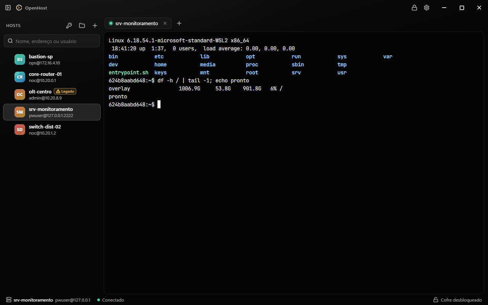
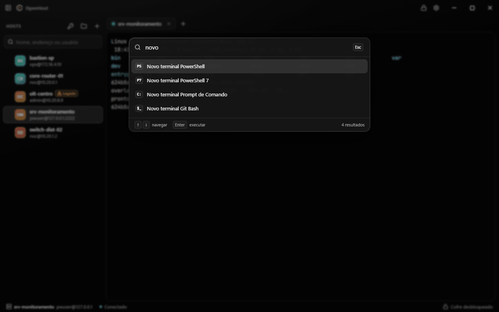
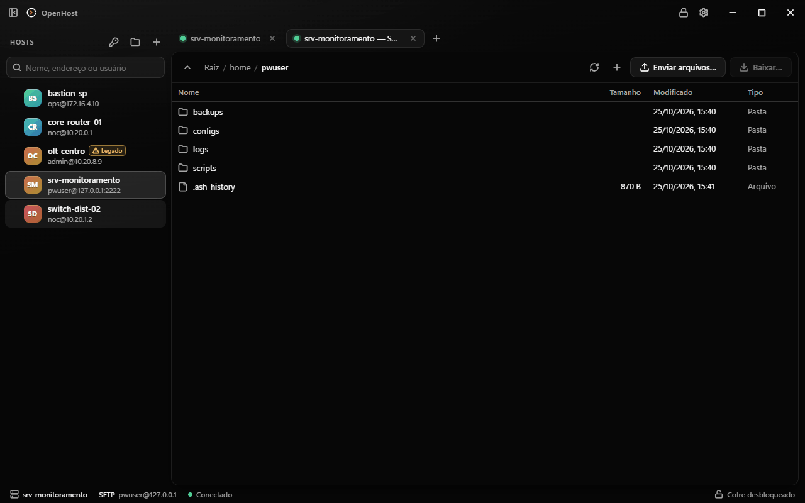
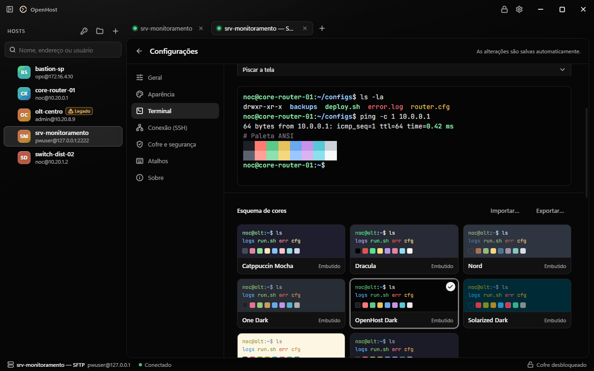
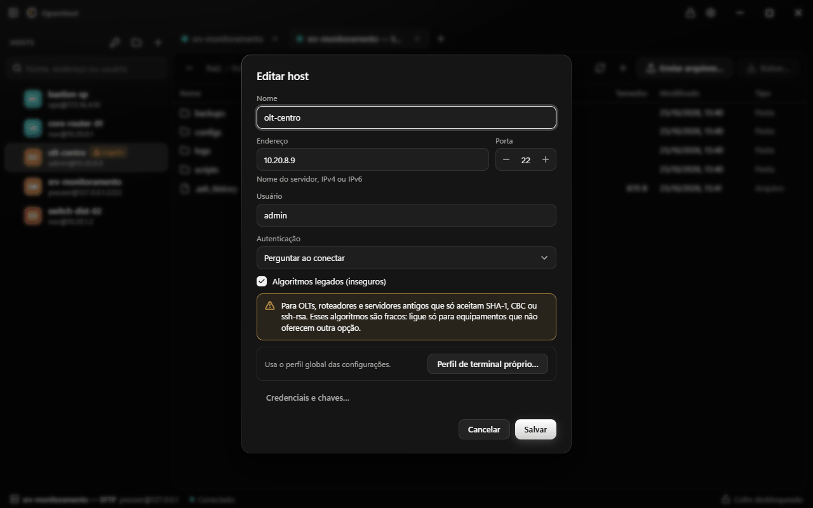
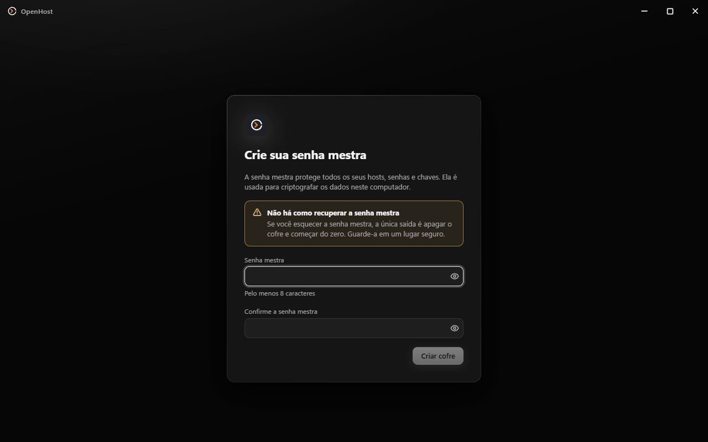

# OpenHost

OpenHost é um cliente SSH desktop local-first para Windows, Linux e macOS. Ele reúne terminal SSH e local,
cofre criptografado, organização de hosts e credenciais, SFTP, encaminhamento de portas e
perfis de terminal em uma aplicação nativa construída com Go, Wails e React.

O nome visível do produto é **OpenHost**. Identificadores internos e o diretório de dados
continuam usando `ShellVault` para manter compatibilidade com versões anteriores.

**[Baixar para Windows, Linux ou macOS](https://github.com/EmersonRicard0/Openhost/releases)**



| | |
|---|---|
|  |  |
| **Paleta de comandos** (Ctrl+Shift+P): hosts, terminais locais detectados e ações. | **SFTP** com transferências em paralelo, na mesma aba de trabalho. |
|  |  |
| **Personalização ao vivo**: fonte, tamanho e esquemas de cores, com importação de Windows Terminal e iTerm. | **Equipamentos legados**: algoritmos antigos por host, com aviso permanente na lista. |



O cofre é criptografado com a senha mestra (Argon2id + XChaCha20-Poly1305) e nunca sai do
computador.

## Instalar

Baixe o arquivo do seu sistema na [página de releases](https://github.com/EmersonRicard0/Openhost/releases):

| Sistema | Arquivo | Versão mínima |
|---|---|---|
| Windows | `OpenHost-<versão>-windows-amd64-installer.exe` | Windows 10 (64 bits) |
| macOS (Intel e Apple Silicon) | `OpenHost-<versão>-macos-universal.dmg` | macOS 12 |
| Ubuntu, Debian | `openhost_<versão>_amd64.deb` | Ubuntu 22.04, Debian 12 |
| Fedora, openSUSE | `openhost-<versão>-1.x86_64.rpm` | Fedora 39, openSUSE Leap 15.5 |
| Qualquer Linux | `OpenHost-<versão>-x86_64.AppImage` | WebKitGTK 4.1 instalado |

**Primeira abertura no macOS.** O app ainda não tem assinatura da Apple. Arraste-o para
Aplicativos, clique com o botão direito nele e escolha **Abrir** (no macOS 15+, use **Ajustes do
Sistema → Privacidade e Segurança → Abrir Mesmo Assim**). Pelo Terminal:
`xattr -dr com.apple.quarantine /Applications/OpenHost.app`.

**Linux.** `sudo apt install ./openhost_<versão>_amd64.deb` ou
`sudo dnf install ./openhost-<versão>-1.x86_64.rpm`; o AppImage roda com `chmod +x` e não precisa
instalar. Desinstalar não apaga o cofre.

O cofre fica em `%APPDATA%\ShellVault` no Windows, `~/.config/ShellVault` no Linux e
`~/Library/Application Support/ShellVault` no macOS.

## Requisitos para desenvolver

- Go 1.26 ou superior. O módulo declara Go 1.26.0.
- Wails CLI 2.17.0:

  ```sh
  go install github.com/wailsapp/wails/v2/cmd/wails@v2.17.0
  wails doctor
  ```

- Node.js 24 LTS e npm para compilar e testar o frontend.
- Docker para os servidores SSH dos testes de integração e E2E e para validar o Linux.

Por sistema:

- **Windows**: Windows 11 ou 10; WebView2 Runtime (já vem no Windows 11); NSIS para gerar o
  instalador com `wails build -nsis`; OpenSSH Client e `ssh-agent` para validar o agente.
- **Linux**: compilador C, GTK 3 e WebKitGTK 4.1. No Ubuntu/Debian:
  `sudo apt install build-essential pkg-config libgtk-3-dev libwebkit2gtk-4.1-dev`. Todo comando
  `go`/`wails` leva `-tags webkit2_41` (o Wails 2 procura o WebKitGTK 4.0 sem ela).
- **macOS**: Xcode Command Line Tools (`xcode-select --install`).

Instale as dependências das ferramentas de teste e do frontend depois de obter o repositório:

```sh
npm ci
npm --prefix frontend ci
```

## Desenvolvimento

Na raiz do repositório, inicie o aplicativo com recarga automática do frontend:

```sh
wails dev                      # no Linux: wails dev -tags webkit2_41
```

O Wails usa `frontend/` como projeto web e executa os scripts definidos no
[`wails.json`](wails.json).

## Build

Os builds otimizados saem em `build/bin/`:

```sh
# Windows: executável e instalador NSIS
wails build -clean -nsis -trimpath -ldflags "-s -w"

# Linux
wails build -clean -tags webkit2_41 -trimpath -ldflags "-s -w"
scripts/package-linux.sh 0.4.0 amd64          # .deb, .rpm e AppImage em dist/ (nfpm e appimagetool)

# macOS (Intel e Apple Silicon no mesmo .app)
wails build -clean -platform darwin/universal -trimpath -ldflags "-s -w"
scripts/package-macos.sh 0.4.0                # .dmg em dist/
```

O executável mantém o nome interno `shellvault`; o produto instalado é apresentado como
OpenHost. Para validar os pacotes do Linux em contêineres (Ubuntu 22.04 e 24.04, Fedora 39):
`scripts/linux-docker-check.sh`.

## Publicar uma versão

O workflow de release é disparado por tags no formato `vX.Y.Z`. Antes de publicar, mantenha o
número em `wails.json` alinhado com a tag, escreva `docs/release-notes/X.Y.Z.md` e confirme que
`node scripts/check.mjs` está verde.

Crie e envie a tag a partir do commit que será publicado:

```sh
git tag v0.4.0
git push origin v0.4.0
```

O GitHub Actions compila nos três sistemas, confere os binários, gera o instalador do Windows, o
`.dmg` universal e os pacotes do Linux (amd64 e, quando der, arm64), publica tudo com o
`SHA256SUMS.txt` e usa as notas de `docs/release-notes/`. Tags com sufixo, como
`v0.4.0-rc.1`, saem como pré-release.

## Testes

Testes Go:

```powershell
go test ./...
```

Testes unitários do frontend:

```powershell
npm --prefix frontend run test
```

O teste de abertura compila o app com `-tags smoke`, abre com um diretório de dados vazio, cria
cofre, host e chave e confere que nenhum segredo ficou legível em disco (no Linux sem tela, use
`xvfb-run`):

```sh
node scripts/smoke.mjs
```

O portão de qualidade completo também executa `go vet`, testes Go, verificação de tokens,
lint, verificação de tipos e testes do frontend:

```powershell
node scripts/check.mjs
```

Para os testes de integração, inicie primeiro as fixtures Docker e depois execute os pacotes
Go com a tag `integration`:

```powershell
node scripts/sshd.mjs up
go test -tags integration ./internal/...
```

Ao terminar, os contêineres podem ser removidos com:

```powershell
node scripts/sshd.mjs down
```

Os testes E2E são executados a partir de `frontend/`. O setup do Playwright gera
automaticamente um build Wails com a tag `e2e`:

```powershell
Set-Location frontend
npx playwright test
```

Quando `build/bin/shellvault-e2e.exe` já tiver sido gerado e não precisar ser recompilado,
use `SHELLVAULT_E2E_SKIP_BUILD=1`:

```powershell
$env:SHELLVAULT_E2E_SKIP_BUILD = "1"
npx playwright test
Remove-Item Env:SHELLVAULT_E2E_SKIP_BUILD
```

## Importar e exportar

Em **Configurações › Importar e exportar** (ou no botão de setas da barra de hosts) dá para
trazer hosts de outros programas:

| Origem | O que é lido |
|---|---|
| OpenSSH | `~/.ssh/config`, com `Include`, padrões `Host *` e chaves de `IdentityFile` |
| PuTTY e KiTTY | no Windows, sessões SSH do registro; em todos os sistemas, a pasta `Sessions` do KiTTY portátil; chaves `.ppk` |
| Planilha CSV | UTF-8 ou Windows-1252, separador detectado; há um modelo para baixar |
| MobaXterm | arquivo `.mxtsessions` ou `MobaXterm.ini`; pastas viram grupos |
| SecureCRT | XML de *Tools › Export Settings*; pastas viram grupos |
| OpenHost | arquivo `.openhost` exportado por este app, com ou sem chaves |

Nada é gravado antes da prévia: nela você corrige endereço, porta e usuário, escolhe o que entra,
decide o que fazer com duplicados (pular, substituir ou manter os dois) e vê avisos de opções que
não têm equivalente. Senhas salvas nesses programas nunca são lidas; o host pede a senha na
primeira conexão. A última importação pode ser desfeita.

Para exportar, use **Exportar…** na mesma tela, no menu de um grupo ou no de um host:

- **OpenHost** (`.openhost`): para levar tudo a outro computador. Com *Incluir chaves privadas*,
  o arquivo inteiro é criptografado com uma senha sua (Argon2id + XChaCha20-Poly1305) e a senha
  mestra é pedida antes; sem chaves, ele não contém segredo nenhum, mas endereços e usuários
  ficam legíveis.
- **OpenSSH**: blocos `Host` para um arquivo novo ou acrescentados ao `~/.ssh/config`, entre
  marcadores do OpenHost e com cópia de segurança do arquivo antes.
- **CSV**: no mesmo modelo da importação.

## Migração do cofre anterior

No Windows, a versão Wails reconhece automaticamente o cofre da versão 001 no diretório:

```text
%APPDATA%\ShellVault
```

Quando `vault.svlt` existe e ainda não há `shellvault.db`, a tela de desbloqueio informa que
encontrou um cofre anterior. Ao digitar a senha mestra correta, o aplicativo migra numa única
transação:

- grupos e sua hierarquia;
- hosts e ordem de exibição;
- credenciais de senha e chave;
- chaves de servidores já conhecidas;
- regras de encaminhamento;
- configurações do cofre e preferências da interface.

Depois de gravar e conferir o novo `shellvault.db`, o arquivo original é preservado como
`vault.svlt.migrated`. Se a senha estiver errada ou a migração falhar, o arquivo original não é
alterado e a operação pode ser tentada novamente.

Mais detalhes de validação estão em
[`specs/002-wails-migration/quickstart.md`](specs/002-wails-migration/quickstart.md).
